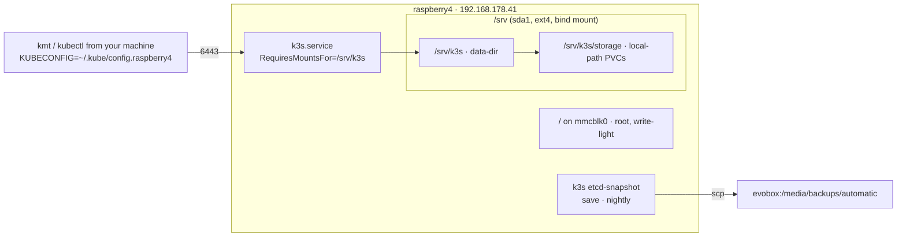

# Plan: single-node k3s reference cluster (raspberry4)

Status: planned, not started. Owner: Julian. Target host: `raspberry4` (Pi 4, 8 GB, arm64, Debian 13 trixie).

## 1. What this is, and what it is not

A one-node k3s cluster that kubementat's automations are installed onto **by hand, by the owner**,
to answer the question the VM suite cannot answer cheaply: *does kubementat work on a real, slow,
single-node, non-cloud cluster?*

`examples/k3s/setup-k3s.sh` is the delivered artefact. It is a **fixture recipe**, not a feature.
The boundary matters more than the script:

- `src/**` never learns that `examples/k3s/` exists. No command, no config key, no constant.
- `tests/e2e/stages/01-provision.sh` stays the **only** provisioner the harness runs. The Pi script
  is never executed by kubementat code, and never promoted into the harness.
- That boundary gets a test, not a comment (see §6, D1).

The reason for the hard boundary: two bootstrap paths that both work are how a fixture becomes an
implicit feature and then silently drifts from the one the harness actually validates.

## 2. Why this shape is defensible (measured, not assumed)

Host state, taken 2026-10-30 (before the phase-0 changes below):

```
4x Cortex-A72 @1.8GHz · 7.6Gi RAM (269Mi used) · 2Gi swap ACTIVE
/            mmcblk0p2  29G  4.6G used
/srv         sda1       110G   16M used
docker ps    empty      ·  cgroup v2, systemd driver
controllers: cpuset cpu io pids          ← no memory
```

The capacity claim comes from the harness's own lane table, not from optimism:

From `tests/e2e/harness/config.py`, whose four lanes are the whole table:

| lane | vcpu | RAM | disk | what it applies |
|---|---|---|---|---|
| `smoke` | 4 | 6 GiB | 25 GiB | the `standard` group |
| `full` | 8 | 16 GiB | 50 GiB | `standard`, then `routing` through `kmt routing install` |
| `routing` | 8 | 16 GiB | 50 GiB | `standard`, plus the `routing_ingress` and `routing_guard` features |
| `bootstrap` | 4 | 6 GiB | 25 GiB | `standard` once, with nothing written by hand in between |
| **raspberry4** | **4** | **7.4 GiB usable** | **110 GiB** | — |

So: **the Pi is a `smoke`-shaped fixture and not a `full`/`routing` substitute.** It runs the
standard group and nothing that wants 8 cores. The extra 85 GiB of SSD is the difference that makes
backing services (Postgres/Redis/Mongo) plausible there when the smoke VM cannot afford them.
Saying this out loud is the point: it sets expectations for what a green run on the Pi means.

## 3. Design decisions

**D1 — fixture, not surface.** `examples/k3s/setup-k3s.sh` plus a README. A test asserts nothing
under `src/` references `examples/`, and that the harness's provisioner is `stages/01-provision.sh`
(§6). Without the test the boundary is a wish.

**D2 — parameter-free, idempotent, one-shot.** Same contract as `01-provision.sh` (FR-13): no
arguments, no environment, re-runnable after a partial failure, every step guarded by a
"has this already happened" check rather than by a version of the script. It writes a
`facts` record (`k3s --version`, `helm --version`, resolved arch) as its own evidence.

**D3 — k3s's bundled Traefik is disabled at bootstrap.** `disable: ["traefik"]` in
`/etc/rancher/k3s/config.yaml` — the mechanism the `routing` lane already uses. Left alone,
k3s's controller is a **foreign** controller by `traefik_presence.py`'s own classification, and
`kmt routing install` then refuses to own routing on the cluster you built for the express purpose
of testing it. This is the single most important non-obvious step in the whole script.

**D4 — `data-dir` lives on the SSD, and the mount dependency is proven.** `data-dir: /srv/k3s` plus
a `RequiresMountsFor=/srv/k3s` drop-in on `k3s.service`. This is lesson L6 from the reflash notes,
applied one component over: k3s's unit ships without the dependency, so on a reboot it races
`srv.mount` and its etcd quietly lands on the SD card. The proof is `systemctl show k3s.service
-p Requires` containing `srv.mount`, not a log line.

**D5 — memory cgroup is a precondition, not a step.** The shipped `.dtb` bootargs carry
`cgroup_disable=memory`, so it is absent from `cmdline.txt` and not fixable from there. The
Raspberry Pi kernel responds to `cgroup_enable=memory` appended to `cmdline.txt`
(raspberrypi/linux#6980, PR#7442). The script fails loudly with that instruction when
`/sys/fs/cgroup/cgroup.controllers` has no `memory`, because kubelet memory limits without the
controller look identical to working ones and are silently dropped.
**Verified 2026-10-30:** appending `cgroup_enable=memory` to `/boot/firmware/cmdline.txt` works on
this kernel, and the enforcement is real — a scope started with `MemoryMax=64M` and 200 MB of
anonymous pages was OOM-killed, which is the only check that distinguishes a mounted controller
from a usable one.

**D6 — swap is off and stays off.** 2 GiB of swap was active and kubelet's default `failSwapOn: true`
refuses to start. Masking the zram units is the wrong lever: swap here is owned by the `rpi-swap`
package, which generates its units from `/etc/rpi/swap.conf` (`Mechanism=auto` → `zram+file`). The
supported knob is a drop-in setting `Mechanism=none`, which also removes `/var/swap`. The reboot is
what proves it.

**D7 — storage stays `local-path`.** k3s's built-in provisioner is what the storage-class keys already
name: `TEKTON_KUBERNETES_STORAGE_CLASS` answered by the environment layer and by `constants.py`, and
`MYSQL_VOLUME_STORAGE_CLASS` / `REDIS_VOLUME_STORAGE_CLASS` spelled in the team template. All three
carry `local-path`, so nothing needs installing. Longhorn/TopoLVM on a USB-attached SSD on a 4-core A72
is a second failure mode, not a feature.

**D8 — k3s version is pinned and checked. Amended 2026-11-05; it used to read "recorded, not
pinned."** The original reasoning was that pinning the Pi would create a cluster that is not the cluster
the harness tests. That held only while the harness ran *some* cluster: with no lane pin, parity with
the Pi meant parity with whatever the stable channel handed out that day, so the parity claim could not
be checked against anything.

The first real run after three days without one settled it. The channel promoted this host's guest to
`v1.37.2+k3s1`, its `helmcharts.helm.cattle.io` never finished establishing, k3s fatal-looped every
cycle, and the suite died in `01-provision` without reaching `02-install` — with the recorded version
pointing accurately at a change nobody had chosen. Recording had been the whole implementation, and it
had never been read by anything. The lane already pins helm and helmfile for the same reason, so k3s was
the exception rather than the rule.

So: `01-provision.sh` pins, the provision stage asserts the guest's answer against that pin, and the
version still lands in the facts file. Which version is pinned is a separate question from whether to
pin, and the answer stays the one this document should always give — the release the last green full run
recorded, not the newest one. The Pi keeps its own version and is checked against the lane's, so
"parity" now means a comparison and not a hope.

**D9 — the Pi is never a gate.** No CI, no schedule, no harness lane points at it. Its uptime is
one kernel update and one SD card away from a reboot; a suite that depends on it would be measuring
the SD card.

**D10 — state backups, on day one, as SQLite rather than etcd.** The claim that embedded etcd gives
`k3s etcd-snapshot save` for free is **false on this cluster**: single-node k3s without
`--cluster-init` uses SQLite/kine, and `k3s etcd-snapshot save` fails with `etcd datastore disabled`.
Staying on SQLite is also the parity choice — `tests/e2e/stages/01-provision.sh` installs k3s with no
flags, so matching it outweighs the nicer snapshot UX. The bundle is a `sqlite3 .backup` of
`state.db` (the WAL-safe API, not `cp`), plus the `server/` tree that makes it bootable again (tls,
cred, manifests, tokens), plus `storage/`. Daily timer, 14 kept locally, pushed to
`evobox:/media/backups/automatic/k3s-raspberry4/` through a forced command that cannot buy a shell.
An all-in-one node means control plane, database and PVCs die together, so this is part of the shape
— but the **restore path is still unexercised** and needs a drill before it is needed.

## 4. Layout



## 5. Script contract

```
examples/k3s/setup-k3s.sh            # one-shot, idempotent, no args. bootstrap only.
examples/k3s/README.md               # what it does, what it does not, how to verify, how to undo
examples/k3s/kubeconfig-client.md    # exporting 6443 to a control machine (short, explicit)
```

Order of operations, each one verified against the resulting artefact:

1. Assert arch/platform and that `/srv` is a mount (`findmnt /srv` → `sda1[/srv]`).
2. Assert memory cgroup (D5) — abort with the fix.
3. Swap off via the `rpi-swap` drop-in (`Mechanism=none`), `swapon --show` empty.
4. Tooling that kubementat's dependency check needs: `helm`, `helmfile`, `tkn`, `kubectl`, `git`,
   `gpg`, `python3`, `pip`. The helm and helmfile versions come from `PINNED_BINARY_VERSIONS` in
   `src/kubementat/core/constants.py` read out of the checkout, exactly as `01-provision.sh` does, and
   never from a literal in this script. `git-crypt` is not in the dependency check and is still needed
   by `config init`; `yq` and `jq` are installed by the provisioner and are not needed by kubementat.
5. k3s from `get.k3s.io`, then `/etc/rancher/k3s/config.yaml` with `data-dir`,
   `write-kubeconfig-mode: 644`, `disable: ["traefik"]`, then the drop-in, then restart.
6. kubeconfig: `write-kubeconfig-mode: 644` (the provisioner's own fix — `k3s.yaml` is reset to 0600
   by k3s on every restart and `load_kube_config` fails on it) plus the `~/.kube/config` symlink.
7. Verification block: every check below, printed as a table, exit non-zero on any failure.

The verification block is the part that is worth more than the install. The lesson from the reflash
notes applies verbatim — *a command exiting 0 proves the command ran, not that the change exists* —
so the script reads back: controllers, `swapon`, `findmnt /srv`, `systemctl show k3s -p Requires`,
`kubectl get nodes -o json` for allocatable, `kubectl get sc` for `local-path (default)`, and
`kubectl get pods -A -o jsonpath` for "no traefik anywhere".

## 6. Verification

| check | the artefact | passes when |
|---|---|---|
| memory cgroup | `/sys/fs/cgroup/cgroup.controllers` | contains `memory` |
| swap | `swapon --show` | empty |
| data-root | `findmnt` of k3s's own dirs, `/var/lib/rancher` absent | under `/srv/k3s` |
| mount race | `systemctl show k3s.service -p Requires` | contains `srv.mount` |
| arch | `kubectl get nodes -o jsonpath='{...arch}'` | `arm64` |
| storage | `kubectl get sc` | `local-path` and it is the default |
| routing is clean | `kmt routing status <env>` | classification `none`, and says so |
| end-to-end | `kmt config init` → `install` → `uninstall` | cluster empty afterwards, checked by the same sweep the harness uses |
| persistence | reboot twice, re-run the verification block | all rows still pass |

Boundary test (D1): a file that fails if `src/**` mentions `examples/k3s`, or if
`tests/e2e/harness` gains a provisioner other than `stages/01-provision.sh`. That is the cheapest
thing in this plan that keeps the next person from quietly making the fixture a feature.

## 7. Phases

| # | work | done when | effort |
|---|---|---|---|
| 0 | ✅ done 2026-10-30: `cgroup_enable=memory` + `rpi-swap Mechanism=none`, reboot ×2 | `cgroup.controllers` lists `memory`, OOM limit enforced, 0 failed units | done |
| 1 | ✅ done 2026-10-30: k3s v1.36.5+k3s1, `data-dir=/srv/k3s`, traefik disabled, drop-in | `raspberry4 Ready` arm64, no traefik pods, survives reboot | done |
| 2 | kubementat: `config init`, `install` (standard group), `routing install`, `uninstall` | the §6 table passes; Pi is empty again | 1–2 h, mostly waiting |
| 3 | Write `examples/k3s/` from what actually worked, not from the notes | script reproduces phase 1–2 on a re-run | 1 h |
| 4 | Boundary test + README | test green, README states the fixture boundary | 30 min |
| 5 | ✅ done 2026-10-30: state bundle (SQLite, not etcd) + daily timer → evobox | off-box bundle exists, `state.db` sha256 = manifest, `integrity_check=ok`, timer armed |
| 6 | *(optional)* Pi-shaped config: distinct environment (D8 below) | `kmt <cmd> <env> <team>` reads a Pi env | 30 min |

Phase 2 is the one that decides whether the whole idea holds. Everything before it is prerequisites;
everything after it is documentation of what worked.

## 7b. What phases 0–1 actually found (2026-10-30)

Host, before k3s:

- swap is owned by the `rpi-swap` package, which *generates* its units from `/etc/rpi/swap.conf`
  (`Mechanism=auto` → `zram+file`). Masking the zram units is fighting a generator that runs every
  boot; the supported knob is a drop-in (`/etc/rpi/swap.conf.d/10-kubernetes.conf` →
  `[Main] Mechanism=none`), which also deleted `/var/swap`.
- `cgroup_disable=memory` is still printed in `/proc/cmdline` *after* the fix, because it comes from
  the `.dtb` and sits ahead of the cmdline.txt content. `cgroup_enable=memory`, appended after it,
  wins on the `+rpt` kernel. **Reading `/proc/cmdline` gives a confidently wrong answer here** —
  read `cgroup.controllers`, then prove enforcement (a `MemoryMax=64M` scope with 200 MB of
  anonymous pages was OOM-killed, which is the only check that separates a mounted controller from
  a usable one).

k3s v1.36.5+k3s1, all verified against artefacts rather than exit codes:

| check | result |
|---|---|
| node | `raspberry4 Ready control-plane`, arm64, containerd 2.3.4-k3s1 |
| data | `/srv/k3s` in use, `/var/lib/rancher` absent, `srv.mount` in `Requires` |
| storage | `local-path` default; a probe pod wrote a marker, it was read back on the host under `/srv/k3s/storage/…`, on `/dev/sda1`, both ways, and cleanup left 0 pods / 0 PVs |
| controller | zero traefik objects anywhere |
| memory | `kubectl top nodes` answers (1113Mi/14%) — memcg is live end to end |
| reboot | fresh boot, all 3 kube-system pods Running, probe re-passed, 0 failed units, `k3s.yaml` still 0644 |

**The finding that will bite phase 2:** after a reboot, kubelet starts pods before the embedded
flannel has written `/run/flannel/subnet.env`, so the first sandbox creation fails with
`plugin type="flannel" failed (add): failed to load flannel 'subnet.env' file`. It self-heals in
under a minute (`SandboxChanged`), but it means anything that *verifies cluster startup* — a probe
pod, a `kubectl wait`, kubementat's own install assertions — must retry across that window instead
of reading one sandbox failure as an install failure. The `Completed` status seen mid-boot on the
local-path provisioner was the same race seen from the other side: it was the previous container's
`lastState`, not a crash.

### The backup, and the place the plan was simply wrong

The plan claimed `k3s etcd-snapshot save` comes free with embedded etcd. **It does not exist on this
cluster**: single-node k3s without `--cluster-init` uses SQLite/kine, and the command fails with
`etcd datastore disabled`. The fix was not to add `--cluster-init` — the harness's provisioner installs
plain k3s, so SQLite is the parity choice and matching it outweighs the nicer snapshot UX — it was to
back the datastore up as what it is.

The bundle is `sqlite3 .backup` of `state.db` (the API that survives the WAL; `cp state.db*` is the
thing that looks healthy and fails on restore) + the `server/` tree that makes it bootable again (tls,
cred, manifests, tokens, minus the live db files and `kine.sock`) + `storage/` + a `MANIFEST` carrying
`state_db_sha256` and `integrity_check`. `agent/` is excluded: containerd comes back by pulling.
Daily 03:15, `Persistent=true`, 14 kept locally, pushed to `evobox:/media/backups/automatic/k3s-raspberry4/`.

Two lessons from building the push, both worth keeping: rsync as the forced command failed on a
client/server version mismatch (`buffer overflow: recv_rules`), so the push is a plain stream to a
fixed receiver script — fewer clever flags, more determinism. And the boundary is tested rather than
claimed: running `id` through the backup key returns `receive: no header`, so the forced command ran
and no shell was available.

Still unexercised: **the restore.** The bundle was extracted off-box and inspected — sha256 equal to
the manifest, 35 TLS files, 8 cred files, `integrity_check=ok` — but the cluster has never been
rebuilt from one.

## 8. Open decisions

1. **Environment identity.** A cluster is one `ENVIRONMENT` in `platform_config/`. Reuse `dev`, or
   add a distinct one (`pi`, or `lab`) that is gitignored the way `platform_config/dev/smoke/`
   already is? Reusing `dev` means a Pi run edits the file the VM runs edit. A separate
   gitignored environment is one line of `.gitignore` and keeps the two honest.
2. **Where `kmt` is driven from.** Your laptop over 6443, or the Pi itself (`kmt` installed via
   `uv`, as the provisioner does). The Pi saves you a kubeconfig but puts a Python venv on the box
   you are trying to keep clean.
3. **Routing on the Pi.** The `routing` lane's cert-manager/HTTP-01 path needs a real, publicly
   resolvable domain. The Pi sits behind NAT on `192.168.178.0/24` with a dynamic IPv6. Either
   declare routing out of scope for the Pi fixture (recommended: it is what the `routing` lane is
   for) or decide on DNS-01 now. Do not let "let me just point a subdomain at it" turn into an
   afternoon.
4. **What breaks first.** k3s's own upgrade channel is an unattended `apt`/install-script question
   on a box whose SD card you only found to be an endurance problem because it broke. Snapshot
   before every k3s upgrade.

## 9. Out of scope

Multi-node (dgx as a worker), mixed-arch scheduling, service mesh, GPU anything on the Pi, CI that
gates on this cluster, and any change to `src/` beyond the one boundary test.
